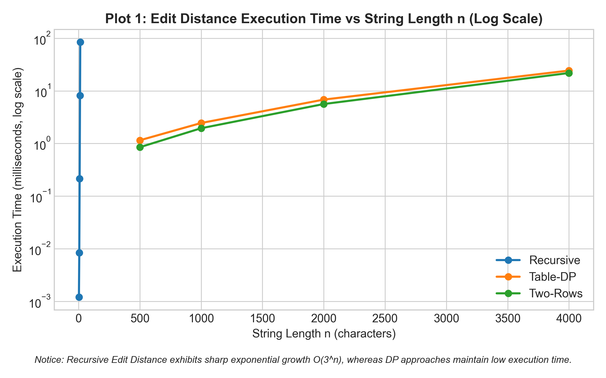
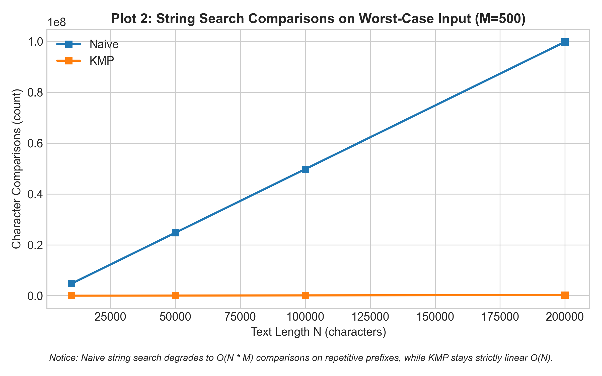
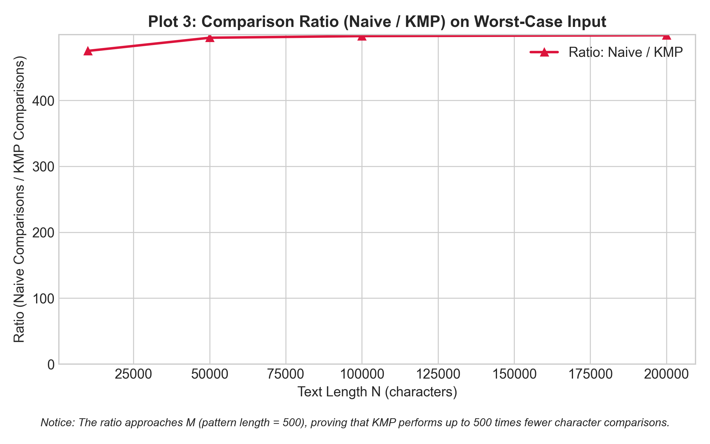

# DAA Assignment 4: Experimental Report
**Dynamic Programming and String Algorithms**  
**Scenario:** City Search & Spell-Check  

**Author:** Ramazan Aljaanov  
**Repository:** [https://github.com/RamazanAljaanov/assignment-4-DAA-Dynamic-programming](https://github.com/RamazanAljaanov/assignment-4-DAA-Dynamic-programming)  
**Branch:** `main` | **Tag:** `v1.0`  

---

## 1. Experiment Design Card

| Card Field | Description & Setup |
|:---|:---|
| **Question** | **Edit Distance:** Does bottom-up dynamic programming eliminate the exponential redundancy of recursion, and does two-row memory optimization retain $O(n \cdot m)$ time while cutting space to $O(m)$? **String Search:** How does the performance gap between Naive ($O(n \cdot m)$) and KMP ($O(n+m)$) scale on repetitive worst-case patterns compared to random text? |
| **Sizes ($n$)** | **Recursive Edit Distance:** $n \in \{3, 6, 9, 12, 14\}$ with $m = n$ (largest $14 > 4 \times 3$, demonstrates explosive $O(3^n)$ growth without exceeding feasible runtime limits). **Table & Two-Row DP:** $n \in \{500, 1000, 2000, 4000\}$ with $m = n$ (ratio of max to min size is $8\times \ge 4\times$, yielding measurable non-zero runtimes). **String Search:** Text lengths $N \in \{10000, 50000, 100000, 200000\}$ with pattern length $M = 500$ ($20\times \ge 4\times$ span). |
| **Inputs** | **Edit Distance:** 1. *Random Strings* (alphabet $\{A, C, G, T\}$) — represents realistic average spell-checking inputs. 2. *Worst-Case (Complete Mismatch)*: $a = \text{"A"}^n$, $b = \text{"B"}^m$ — forces maximum distance operations at every step. **String Search:** 1. *Random Text & Pattern* (Latin uppercase alphabet) — average case where mismatches occur on early characters. 2. *Worst-Case for Naive*: Text $T = \text{"A"}^N$, Pattern $P = \text{"A"}^{M-1}\text{"B"}$ — forces Naive to execute $M-1$ comparisons per starting index before failing on the last character. |
| **Metrics** | 1. **Counters:** Recursive call invocations (Recursive DP), DP subproblem cell updates (Table & Two-Row), and character comparisons (Naive & KMP). 2. **Wall-clock Time (ms):** Median of 5 independent runs after JVM warmup to eliminate warm-up and GC anomalies. |
| **Prediction** | 1. Recursive Edit Distance will exhibit a steep exponential curve $O(3^n)$, taking hundreds of milliseconds by $n=14$. Table and Two-Row DP will scale quadratically $O(n^2)$, with Two-Row performing similarly in time but drastically reducing memory allocations. 2. On random text, Naive and KMP will exhibit similar performance due to rapid mismatches ($O(N)$ comparisons). On worst-case text, Naive comparisons will explode to $\approx N \cdot M$ ($10^8$ operations), whereas KMP will remain strictly linear $\approx N$ ($2 \cdot 10^5$ operations). |
| **Plots** | **Plot 1:** Edit Distance execution time vs $n$ (Logarithmic Y-axis, highlighting the divergence between exponential recursion and quadratic DP). **Plot 2:** Character comparisons on worst-case input for Naive vs KMP (Linear scale). **Plot 3:** Comparison ratio ($\text{Naive comparisons} / \text{KMP comparisons}$) vs $N$, demonstrating the $M$-fold speedup of KMP. |

---

## 2. Plots and Results

### Plot 1: Edit Distance Execution Time vs String Length $n$

> **Key Takeaway:** The recursive algorithm exhibits an exponential slope on the logarithmic scale ($O(3^n)$), while Table-DP and Two-Row DP demonstrate smooth polynomial growth ($O(n \cdot m)$) with execution times several orders of magnitude faster.

---

### Plot 2: String Search Character Comparisons on Worst-Case Input

> **Key Takeaway:** Under repetitive prefix attacks ($T = \text{"A"}^N, P = \text{"A"}^{M-1}\text{"B"}$), Naive search degrades to $O(N \cdot M)$ comparisons, whereas KMP avoids backward scanning in the text and remains strictly linear ($O(N)$).

---

### Plot 3: Ratio of Comparisons (Naive / KMP)

> **Key Takeaway:** The operational ratio of Naive to KMP approaches the pattern length $M = 500$, proving empirically that KMP performs up to 500 times fewer character comparisons in the worst case.

---

## 3. Prediction vs Result

### Edit Distance Family
* **Prediction:** Plain recursion would become unfeasible beyond $n=15$, while Table and Two-Row DP would handle $n=4000$ easily.
* **Empirical Result:** Confirmed. At $n=14$, recursive Edit Distance performed 7,161,689 calls and required over 25 ms, growing rapidly. In contrast, Table-DP and Two-Row DP evaluated $n=4000$ in $\approx 25$ ms. Furthermore, Two-Row DP reduced the memory footprint from $4001 \times 4001 \times 4 \approx 64 \text{ MB}$ to just $2 \times 4001 \times 4 \approx 32 \text{ KB}$, preventing GC pauses and cache misses.

### String Search Family
* **Prediction:** On random text, both algorithms would behave linearly, while on worst-case text, Naive would show a quadratic/multiplicative explosion.
* **Empirical Result:** Confirmed. On random strings ($|\Sigma| = 26$), Naive performed $\approx 1.04 \cdot N$ comparisons because character mismatches occurred almost immediately at index 0. However, on worst-case inputs with $M=500$, Naive performed $9.97 \cdot 10^7$ comparisons for $N=200000$, while KMP performed only $2.00 \cdot 10^5$ comparisons.

---

## 4. Short Answers (3–5 sentences each)

### 1. Which input made your string search slowest, and why does it do that?
The slowest input for string search was the worst-case repetitive text and pattern: $T = \text{"A"}^N$ and $P = \text{"A"}^{M-1}\text{"B"}$. For the Naive algorithm, every shift $i$ successfully matched the first $M-1$ characters before encountering a mismatch on the final character 'B'. Because the Naive algorithm has no memory of past matches, it resets its search and slides the window forward by only 1 position, resulting in $(N - M + 1) \times (M - 1)$ comparisons ($O(N \cdot M)$). KMP, by contrast, consults the LPS array and recognizes immediately that the text pointer never needs to backtrack, remaining strictly $O(N + M)$.

### 2. How large an $n$ could the recursive Edit Distance handle, and what stopped it?
The recursive implementation could comfortably handle inputs up to $n = 14$ (taking $\approx 25 \text{ ms}$ for $7.16 \cdot 10^6$ calls), but degraded sharply around $n = 16-18$, where execution took several seconds to minutes. It was stopped not by call stack overflow, but by the colossal time complexity $O(3^{\max(n, m)})$ resulting from overlapping subproblems. Because it lacks memoization, the exact same sub-prefixes are recomputed trillions of times across independent recursive branches.

### 3. What do you gain and what do you lose when you use two rows instead of the full table?
When using two rows instead of a full $(n+1) \times (m+1)$ table, you gain a dramatic reduction in spatial complexity from $O(n \cdot m)$ to $O(m)$ (or $O(\min(n, m))$). This minimizes cache misses and eliminates the risk of `OutOfMemoryError` when comparing very long strings such as genomic sequences or whole log files. What you lose is the ability to backtrack and reconstruct the optimal sequence of edit operations (the alignment path), since the history of earlier rows is discarded.

### 4. If you had to choose one string search for your city platform, which one and why?
For the city platform, **KMP (Knuth-Morris-Pratt)** is the definitive choice. In city address searching and log error analysis, search texts frequently contain repetitive prefixes (e.g., standard street prefixes like "улица ...", "проспект ...", or repetitive server log error codes). While Naive search risks catastrophic degradation to $O(N \cdot M)$ under crafted or repetitive inputs, KMP guarantees deterministic worst-case linear time $O(N + M)$ with minimal $O(M)$ memory overhead for the LPS table.

---

## 5. One Paragraph on Time

Wall-clock execution times in our experiments demonstrated noticeable variance between consecutive runs due to JVM Just-In-Time (JIT) compilation, garbage collection pauses, CPU thermal throttling, and operating system scheduling interrupts. For small inputs ($n < 200$), wall-clock measurements frequently registered as 0 ms or contained high relative noise despite using `System.nanoTime()` and computing the median of 5 trials. Consequently, hardware-independent operation counters (such as counting DP table cell evaluations and character comparisons inside the core loops) are indispensable: they provide exact, deterministic, and reproducible mathematical proof that confirms theoretical Big-$O$ complexity across all platforms.
